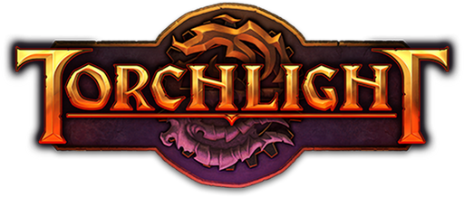
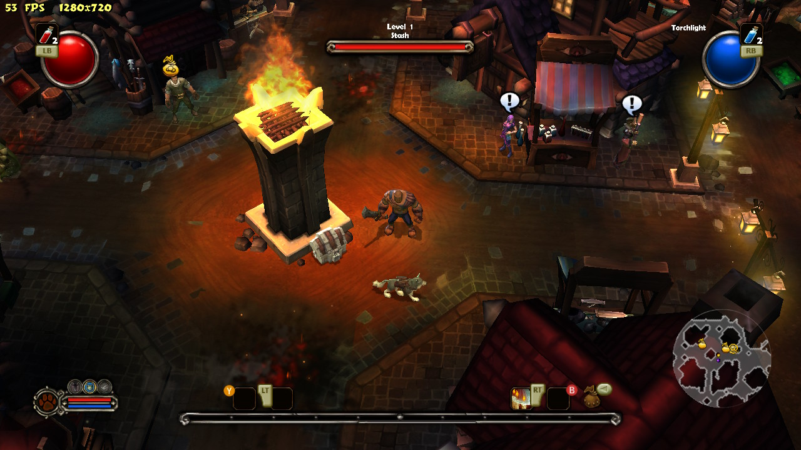
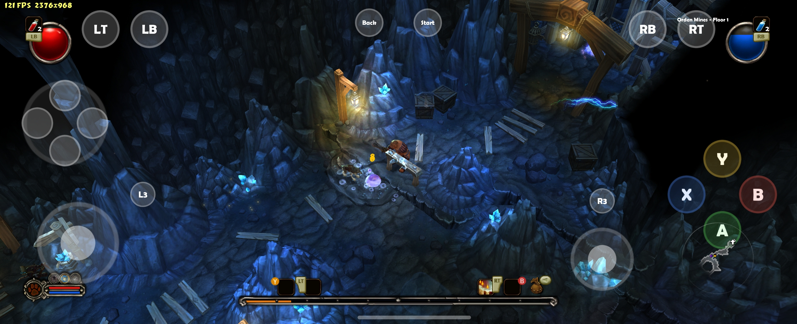

<p align="center">
  
</p>

# Torchlight Rekindled

An engine that runs Torchlight (Runic Games, 2009) on a homebrew-enabled
Nintendo Switch, Android and desktop. Its game logic follows Runic's own
Xbox 360 port of the game (Xbox Live Arcade, 2011). It draws with OGRE 14 and
ParticleUniverse.

**No game data is included.** You need your own copy of the full game: any
purchased PC release (Steam, GOG, Epic, retail) or the Xbox 360 release. The
engine reads it at runtime.

This is a fan project. It is not affiliated with or endorsed by Runic Games or
the owners of the Torchlight trademark.

## Supported platforms

| platform | notes |
| --- | --- |
| Nintendo Switch | homebrew (hbmenu) |
| Android | arm64, Android 12 or newer |
| Windows | desktop build |
| Linux | desktop build |

**About the desktop builds:** I don't own a Steam Deck or any similar handheld
PC, so the Windows and Linux builds have only been tested on a laptop with a
gamepad connected. Reports from handheld PCs are welcome.

## Screenshots

**Nintendo Switch**: the town of Torchlight at night.



**Android**: Orden Mines, floor 1, with the on-screen controls (a Galaxy Z Fold6, 120 fps).



## Why

The PC and Xbox 360 versions of Torchlight both received their last update in
2011. That is more than fifteen years without a patch.

The main motivation for this project is to make Torchlight properly playable on
today's portable devices. The PC version does run on handheld PCs like the
Steam Deck, but it was made for a mouse and keyboard: it has no real gamepad
support and no interface designed for a controller. The Xbox 360 version had
both, and that is the version this engine follows.

Runic Games, the studio behind Torchlight, no longer exists. The Torchlight IP
now belongs to another company whose focus is Torchlight Infinite. With no
sign that the original game will ever be revisited by the people who made it,
this project had to be made.

## Game data

The engine needs two things from your copy of the game:

| file | where it comes from |
| --- | --- |
| `pak.zip` | the game archive. The Xbox 360 release's `pak.zip` is the reference and carries the console interface. A PC release's `Pak.zip` (from its install folder) also works, together with `console_ui/` (see [Using a PC pak with the Xbox interface](#using-a-pc-pak-with-the-xbox-interface)) |
| `music/` | the music folder from your game install. The level themes are not inside the archive. The game runs without it, silently |

Either spelling, `pak.zip` or `Pak.zip`, is accepted.

### Using a PC pak with the Xbox interface

The HUD and menus the engine draws are the Xbox 360 ones. A PC archive does not
have them: it carries the PC's mouse-driven interface instead. To play with a
PC `Pak.zip`, take the console interface (ten files, about 4 MB) from the Xbox
release's `pak.zip` with `scripts/extract_console_ui.py`:

```bash
python scripts/extract_console_ui.py <path to the Xbox 360 pak.zip> console_ui
```

The first argument is the Xbox archive and the second is the folder to write.
The script will not write into the repository's source folders (`src/`,
`scripts/`, `tests/`, ...). `console_ui/` at the repository root is ignored by
git.

Then put `console_ui/` beside the PC `Pak.zip`:

- **Switch and Android** pick up a `console_ui/` folder beside the archive by
  themselves.
- **Windows and Linux** need it named on the command line:
  `--console-ui console_ui` (a path relative to where the program runs, or an
  absolute one).

The engine identifies the archive by its contents. If the archive is the Xbox
360's own, `console_ui/` is not used, because the archive already has the
console interface. If the archive is a PC one and no `console_ui/` is given,
the game has no HUD and the menus are plain lists.

## Configuration: `config.txt`

`config.txt` holds the engine's own switches. These are not the game's
settings, which are kept with the saves (`save/settings.txt`). Each line is
`key=value`, where `1` is on and `0` is off, and `#` starts a comment.

| key | default | does |
| --- | --- | --- |
| `debug` | `0` | the debug tools: the debug menu, the bestiary, the wardrobe editor, Choose Level, frame dumps, and the log file. When off, the menus do not offer them at all |
| `logs` | `0` | the log file on its own (`debug=1` turns it on too) |
| `fps` | `0` | the frame-rate overlay. **L3** toggles it in game, and the change is saved here |
| `width`, `height` | `1280`, `720` | **desktop builds only:** the window size, or the screen resolution in fullscreen |
| `fullscreen` | `0` | **desktop builds only:** `1` fills the screen at `width` x `height` |

**Resolution is a desktop setting.** The Switch and Android builds always
render at their screen's own size and ignore `width`, `height` and
`fullscreen`. They do not write those lines into a new file.

Where the file lives:

- **Switch and Android:** beside the game data. It is created with the
  defaults above on first start.
- **Windows and Linux, run from a player folder** (a `pak.zip` in the working
  directory, as laid out below): in that folder, created on first start with
  the defaults above.
- **Desktop, run from the build tree** (with `--game-data`): read from the
  working directory if one is there, and never created. Without a file the
  debug tools and the log stay on.

On the desktop, `--width` and `--height` on the command line take precedence
over the file.

## Directory structure

Each platform keeps the game files in one folder: the program (or the APK's
chosen folder), `pak.zip`, `music/`, and optionally `console_ui/`. The game
writes `config.txt`, its saves and its log into that same folder.

### Switch

```
sdmc:/switch/torchlight/
├── torchlight.nro      the engine (OGRE's shader library is inside it)
├── pak.zip             the game archive
├── music/              the game's music
├── console_ui/         only beside a PC Pak.zip
└── config.txt          made on first start
```

Start it from the Homebrew Menu (hbmenu).

### Android

The APK holds the engine and OGRE's shader library, but no game files. On
first start it asks for **All files access**, then for a folder chosen through
the system's folder picker:

```
<any folder you choose, e.g. /sdcard/Torchlight/>
├── pak.zip
├── music/
├── console_ui/         only beside a PC Pak.zip
└── config.txt          made on first start
```

The launcher remembers the folder and checks it on every start. If `pak.zip` is
missing it asks again, and if `music/` is missing it offers to play without
music. Android 12 (API 31) or newer is required, on an arm64 device.

### Windows

```
Torchlight/
├── torchlight.exe
├── *.dll               the MinGW runtime, FreeType, zlib, ... (copied by the packaging script)
├── RTShaderLib/        OGRE's shader library, with Main/ inside
├── LICENSE.txt, README.txt, licenses/   the licences of everything in the folder, and where its source is
├── pak.zip
├── music/
├── console_ui/         only beside a PC Pak.zip (run with --console-ui console_ui)
└── config.txt          made on first start
```

Started from this folder with no arguments, it reads the game from the folder
and opens the main menu. Missing files are reported in a message box.

### Linux

```
Torchlight/
├── torchlight
├── torchlight.sh       starts the program from its own folder
├── RTShaderLib/        OGRE's shader library, with Main/ inside
├── LICENSE.txt, README.txt, licenses/   the licences of everything in the folder, and where its source is
├── pak.zip
├── music/
├── console_ui/         only beside a PC Pak.zip (run with --console-ui console_ui)
└── config.txt          made on first start
```

Run `./torchlight.sh`. The system's own libraries are not bundled: X11,
OpenGL/EGL, ALSA, FreeType and zlib. A gamepad is read through evdev. If the
pad is not picked up, add your user to the `input` group.

## Building

Every platform starts from the same checkout:

```bash
git clone --recurse-submodules https://github.com/GreenSwampDweller/torchlight-rekindled.git
cd torchlight-rekindled
python scripts/fetch_stb.py        # the Vorbis decoder (one header), once
python scripts/apply_patches.py    # patches external/ogre and external/particleuniverse
```

Each platform then builds OGRE once (`scripts/build_ogre.py`) and the engine
after it. **Ninja is required everywhere:** on Windows, GNU Make reads the `C:`
in paths as a rule separator and fails.

### Windows (desktop)

Requirements: [MSYS2](https://www.msys2.org/) with the MINGW64 toolchain.

```bash
pacman -S mingw-w64-x86_64-gcc mingw-w64-x86_64-cmake mingw-w64-x86_64-ninja \
          mingw-w64-x86_64-freetype mingw-w64-x86_64-zlib mingw-w64-x86_64-python
```

`C:\msys64\mingw64\bin` must be on `PATH`, not only spelled out in the
commands. Without it the compiler cannot find its own DLLs, and the build fails
with no message.

```bash
python scripts/build_ogre.py --platform desktop
cmake -S . -B build-desktop -G Ninja -DCMAKE_BUILD_TYPE=Release
cmake --build build-desktop
ctest --test-dir build-desktop          # optional: the unit tests
```

To run it straight from the build tree:

```bash
./build-desktop/torchlight.exe --game-data <folder with Pak.zip and music/>
./build-desktop/torchlight.exe --game-data <PC install> --console-ui console_ui
```

To make a player folder (`build-desktop/package/Torchlight/`, laid out as
above):

```bash
python scripts/package_windows.py
python scripts/package_windows.py --pak <your pak.zip> --music <your music/>   # also copies your game files in
```

### Linux (desktop)

Run this on Linux or in WSL. On Debian or Ubuntu the requirements are:

```bash
sudo apt install build-essential cmake ninja-build python3 \
    libx11-dev libxrandr-dev libgl-dev libegl-dev libasound2-dev \
    libfreetype-dev zlib1g-dev
```

```bash
python3 scripts/build_ogre.py --platform linux
cmake -S . -B build-linux -G Ninja -DCMAKE_BUILD_TYPE=Release \
      -DTL_OGRE_BUILD_DIR=build-ogre-linux
cmake --build build-linux
python3 scripts/package_linux.py        # -> build-linux/package/Torchlight/
```

`package_linux.py` takes the same `--pak` and `--music` options as the Windows
script.

### Nintendo Switch

Requirements: [devkitPro](https://devkitpro.org/wiki/Getting_Started) with the
`switch-dev` group and the `switch-mesa`, `switch-sdl2` and `switch-pkg-config`
portlibs. The Switch build uses **devkitPro's own CMake**, run in devkitPro's
MSYS2 shell on Windows. It is not interchangeable with MSYS2's.

**A patched Mesa** (Mesa with glthread, worth about 5 ms a frame on the
console) is linked from `build-mesa-switch/install`. Build it once, in WSL or
Linux with devkitPro installed: `python3 scripts/build_mesa.py`.

Without it the build still succeeds. It links devkitPro's stock Mesa and prints
a warning, and the game runs slower.

```bash
python scripts/build_ogre.py --platform switch
```

On Windows, in devkitPro's MSYS2 shell (it starts in your home folder, so `cd`
first):

```bash
cd /c/path/to/torchlight-rekindled
cmake -S . -B build-switch -G Ninja \
      -DCMAKE_TOOLCHAIN_FILE=/opt/devkitpro/cmake/Switch.cmake \
      -DCMAKE_BUILD_TYPE=Release
ninja -C build-switch
```

This produces `build-switch/torchlight.nro`. Copy it to
`sdmc:/switch/torchlight/` beside `pak.zip` and `music/`, by SD card or over
FTP.

### Android

Requirements, on Windows: [Android Studio](https://developer.android.com/studio),
with the SDK Manager's **NDK (Side by side)**, **CMake** and an **Android SDK
Platform** installed into the default SDK folder (`%LOCALAPPDATA%\Android\Sdk`,
or set `ANDROID_HOME`). The newest installed version of each is used. Gradle is
not needed, and Android Studio's own JDK signs the APK. `build_apk.py` draws the
launcher icons with [Pillow](https://pypi.org/project/pillow/), so the Python
that runs it needs it: `pip install pillow` (or, for MSYS2's Python,
`pacman -S mingw-w64-x86_64-python-pillow`).

```bash
python scripts/build_ogre.py --platform android
python scripts/build_apk.py game                  # -> build-android/torchlight.apk
adb install -r build-android/torchlight.apk
```

The APK is signed with the standard Android debug key
(`~/.android/debug.keystore`, created if it is missing). Put the game files on
the device and choose their folder on first start (see
[Android](#android) above).

## Legal

Torchlight Rekindled is free software, released under the GNU General Public
License, version 3: see [LICENSE](LICENSE). The third-party components it
bundles or links, and their licences, are listed in
[THIRD_PARTY_NOTICES.md](THIRD_PARTY_NOTICES.md).

No part of the game's data is distributed with this project. To play, you need
your own legally obtained copy of Torchlight.

Torchlight is copyright © 2009 Runic Games, Inc. All rights reserved.
Torchlight and Runic Games are trademarks or registered trademarks of their
respective owners in the U.S. and/or other countries.

Torchlight Rekindled and its maintainers are not associated with or endorsed by
Runic Games or the current owner of the Torchlight trademark.
